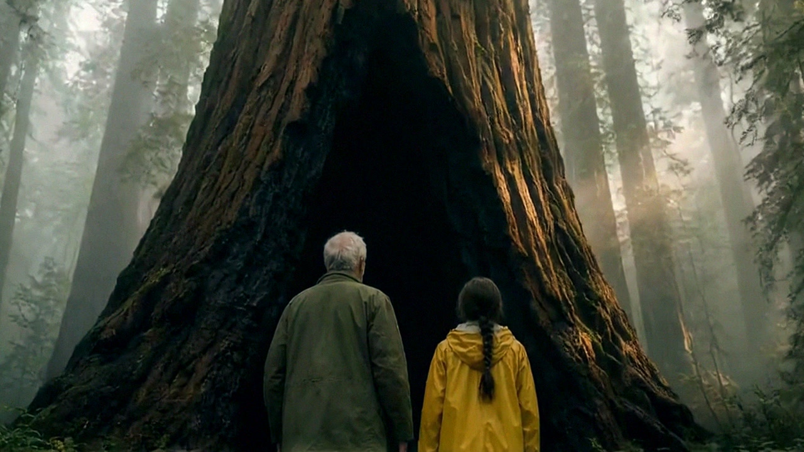
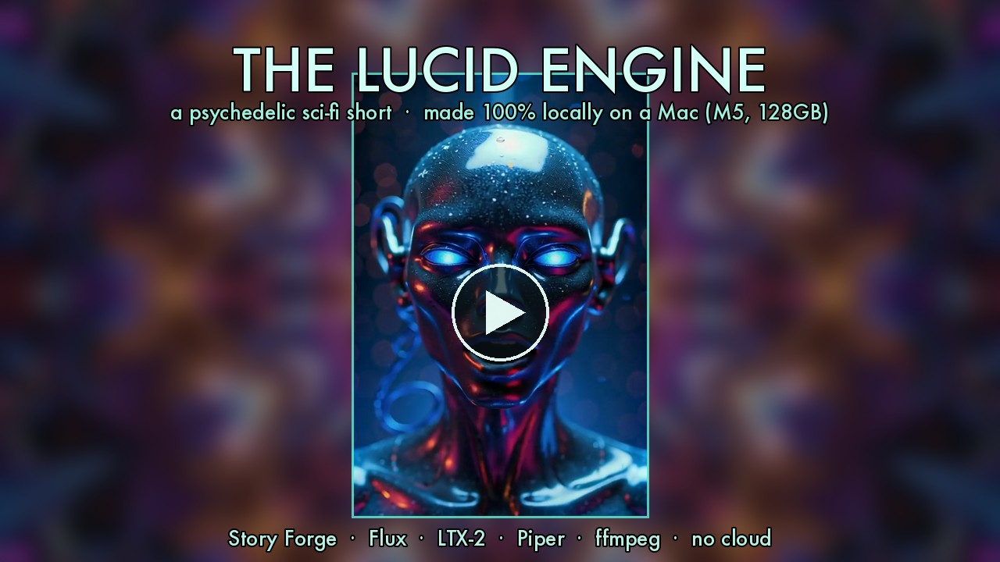

# Story Forge

**Story Forge turns a written story into a finished video on a Mac, with no cloud service.**
You write a script in its `.sf` language (or let the director break a story into beats), and
it makes the pictures, the motion, the voices and the music, then cuts them together. Every
model runs locally on Apple Silicon.

It is for people who want to make short films, explainers, documentaries, promos or music
pieces on their own machine and are comfortable with a terminal. It is not limited to
cartoons; talking characters are just the hardest case, so they are where it gets tested.

[Install](install.md){ .md-button .md-button--primary }
[Quickstart](quickstart.md){ .md-button }
[GitHub](https://github.com/nicedreamzapp/story-forge){ .md-button }

## Films made with it

**The Oldest Tree** (October 2026). A girl, her grandfather, and the oldest redwood in the
forest. Photoreal, 2:53, 49 shots, narrated, original score. From the README: 2,130 stills
were generated and judged by a local vision model (28% passed), plus 270 LTX-2.5 animation
renders, about 105 hours of measured compute on one M5 Max with 128GB.
[Watch on YouTube](https://youtu.be/OaGwc2lGpCo)

- **The Bear Sister** (May 2026): a lost child, a mother bear and a homecoming twenty winters
  later. Two acts, two art styles, 4:08, 43 scenes. [Watch](https://youtu.be/_bFQTl7_vF4)
- **The Lucid Engine** (June 2026): psychedelic sci-fi, five acts, about 4:30, original score.
  [Watch](https://www.youtube.com/watch?v=31ZeFu-ePcc)

Both were made on the first version of the pipeline. Most stages have been replaced since.

## What it does

There are two ways to use it.

**The `.sf` script path.** `bin/sf render film.sf` parses a script, draws a Flux still for
each scene, animates it with Wan 2.2 or LTX-Video through ComfyUI, adds narration and stitches
the cut with ffmpeg. No judging, no retries. This is the path a new user can run.

**The gated director pipeline.** `bin/forge` points a director at a project folder and keeps
working until every story beat has footage that passed. Each shot is drawn (Qwen-Image 2.1),
judged by a local vision model (Qwen3-VL-32B), checked against the cast's faces, locked,
animated (LTX-2.5), judged again and trimmed to the part that holds. Failures feed a concrete
correction into the next attempt. Then it scores, assembles and runs a final QC over the whole
film. This path still has some paths hard-coded to the machine it was built on.

See [How it works](how-it-works.md) for the details.

## What it does differently

- **No cloud calls.** Stills, motion, voices, score and judging all run on the Mac.
- **It judges its own work.** A vision model describes each frame blind, then rules on it
  against the story beat, voting across several frames. A shot that can't pass is reported
  `UNBUILT`, and a check that can't run is reported `UNCHECKED`, never a quiet pass.
- **Memory scheduling.** Heavy models take turns, and a memory gate refuses a render the
  machine can't afford.
- **Measured speed.** The README reports LTX-2.5 at about 69 seconds per shot against 13 to 16
  minutes per shot on Wan for the same job.

## Requirements in one line

An Apple Silicon Mac, Python 3, ffmpeg, and a running ComfyUI with Flux plus Wan 2.2 or LTX.
`./bin/sf doctor` tells you what is missing. Full list on the [Install](install.md) page.

## License

Code is [MIT](https://github.com/nicedreamzapp/story-forge/blob/main/LICENSE). Films have
their own terms in
[LICENSE-ASSETS.md](https://github.com/nicedreamzapp/story-forge/blob/main/LICENSE-ASSETS.md).
Models are credited on the [Credits](credits.md) page.
